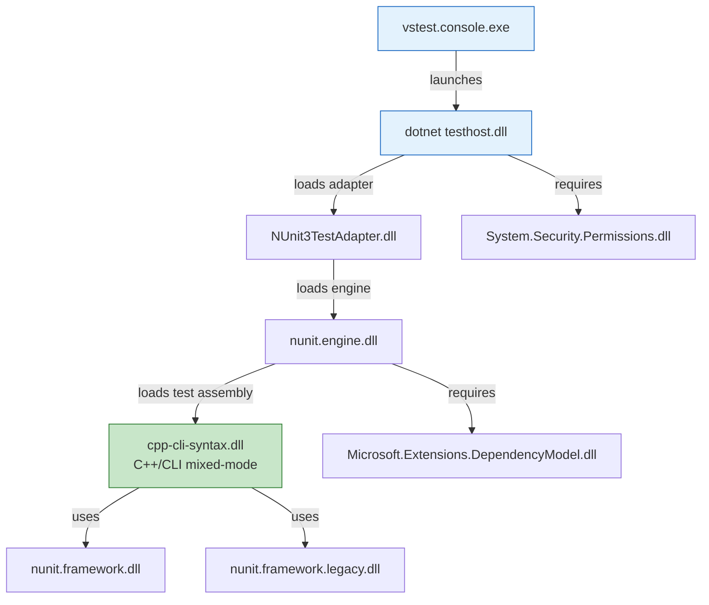
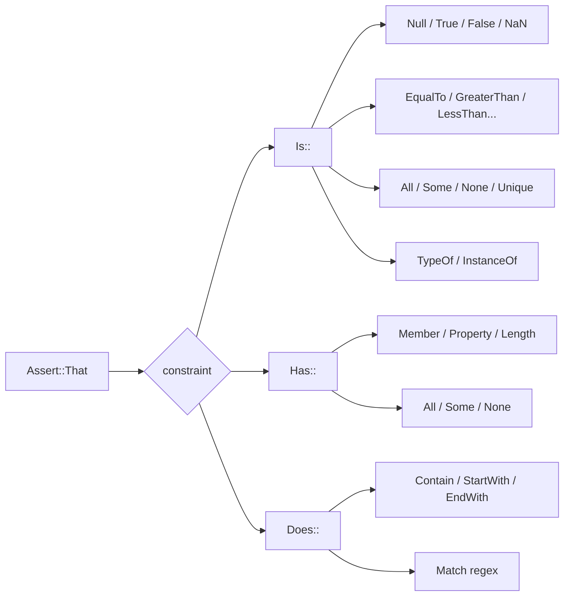
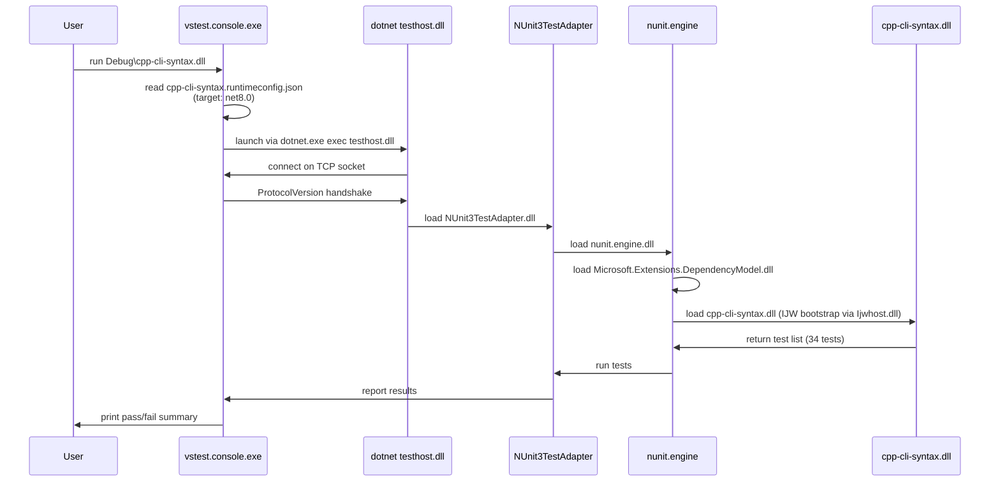

# Unit Testing C++/CLI with NUnit on .NET Core

This guide shows how to set up a C++/CLI project that runs NUnit tests under the modern .NET Core runtime (net8.0). It covers every piece of the puzzle — project configuration, package references, build scripts, and the dependency chain — along with the non-obvious pitfalls that are not documented anywhere else.

> **Why this guide exists:** As of 2026, the combination of NUnit 5 + NUnit3TestAdapter 6.x + C++/CLI on .NET Core is barely documented. This is a working recipe derived from a real project.

---

## Contents

1. [What is C++/CLI?](#what-is-ccli)
2. [Architecture Overview](#architecture-overview)
3. [Prerequisites](#prerequisites)
4. [Project File Configuration](#project-file-configuration)
5. [Package and Assembly References](#package-and-assembly-references)
6. [Post-Build: Copying Runtime Dependencies](#post-build-copying-runtime-dependencies)
7. [Writing Tests](#writing-tests)
8. [NUnit Syntax Styles](#nunit-syntax-styles)
9. [Classic Asserts and the Legacy Namespace](#classic-asserts-and-the-legacy-namespace)
10. [Visual Studio IntelliSense False Positives](#visual-studio-intellisense-false-positives)
11. [Build Script](#build-script)
12. [Test Runner Script](#test-runner-script)
13. [How the Test Pipeline Works](#how-the-test-pipeline-works)

---

## What is C++/CLI?

C++/CLI is a language extension to C++ that adds .NET managed-code support. It lets you write classes that compile to a .NET assembly (a `.dll`) while still having access to native C++ code in the same file. The compiler flag is `/clr:netcore` (or `CLRSupport=NetCore` in the project file for the .NET Core variant).

This makes C++/CLI ideal for:
- Testing native C++ libraries through a thin managed wrapper
- Gradually migrating native codebases to .NET
- Interop layers between managed and unmanaged code

Because the output is a genuine .NET assembly, it can be loaded and tested by NUnit just like a C# test project.

---

## Architecture Overview



All of these DLLs must exist in the same output directory as the test assembly. This is the core challenge of the setup — they do not all arrive there automatically.

### Output directory layout

```
Debug/
├── cpp-cli-syntax.dll              ← your test assembly (C++/CLI)
├── cpp-cli-syntax.pdb
├── cpp-cli-syntax.runtimeconfig.json
├── cpp-cli-syntax.deps.json
├── Ijwhost.dll                     ← IJW (It Just Works) native bootstrap
├── testhost.dll                    ← VSTest test host
├── testhost.deps.json
├── nunit.framework.dll
├── nunit.framework.legacy.dll
├── NUnit3.TestAdapter.dll
├── nunit.engine.dll
├── nunit.engine.api.dll
├── nunit.engine.core.dll
├── testcentric.engine.metadata.dll
├── System.Security.Permissions.dll ← required by testhost/Newtonsoft.Json
└── Microsoft.Extensions.DependencyModel.dll  ← required by nunit.engine
```

---

## Prerequisites

| Requirement | Version used | Notes |
|---|---|---|
| Visual Studio | 2022 or 2026 | Must include **Desktop development with C++** and **.NET desktop development** workloads |
| .NET SDK | 8.0 | Target framework for the test assembly |
| Platform toolset | v145 (VS 2022) | Set in the vcxproj |
| NuGet packages | See below | Restored automatically by MSBuild |

> **Architecture:** The project must be x64. C++/CLI IJW (mixed-mode) assemblies are architecture-specific; the test host and the native code must match.

---

## Project File Configuration

The project file is a standard `.vcxproj` with several .NET-specific additions.

### Global properties

```xml
<PropertyGroup Label="Globals">
    <ProjectGuid>{72448C2D-17C9-419E-B28D-3B533E7E0CD5}</ProjectGuid>
    <RootNamespace>cppclisyntax</RootNamespace>
    <Keyword>NetCoreCProj</Keyword>
    <WindowsTargetPlatformVersion>10.0</WindowsTargetPlatformVersion>
    <TargetFramework>net8.0</TargetFramework>
</PropertyGroup>
```

Key points:
- `Keyword` must be `NetCoreCProj` (not the older `ManagedCProj`) to enable .NET Core mode
- `TargetFramework` **must match** the target framework of the NuGet packages you reference. Using `net10.0` here while your packages are built for `net8.0` causes the testhost to hang silently at startup.

### Configuration properties

```xml
<PropertyGroup Condition="'$(Configuration)|$(Platform)'=='Debug|x64'" Label="Configuration">
    <ConfigurationType>DynamicLibrary</ConfigurationType>
    <CharacterSet>Unicode</CharacterSet>
    <CLRSupport>NetCore</CLRSupport>
    <PlatformToolset>v145</PlatformToolset>
</PropertyGroup>
```

- `ConfigurationType` is `DynamicLibrary` — the test assembly is a `.dll`, not an executable
- `CLRSupport` must be `NetCore` (not the older `true` value which means .NET Framework)
- Platform is `x64` — required for C++/CLI IJW on .NET Core

### Compiler settings

```xml
<ItemDefinitionGroup Condition="'$(Configuration)|$(Platform)'=='Debug|x64'">
    <ClCompile>
        <Optimization>Disabled</Optimization>
        <RuntimeLibrary>MultiThreadedDebugDLL</RuntimeLibrary>
        <WarningLevel>Level3</WarningLevel>
        <DebugInformationFormat>ProgramDatabase</DebugInformationFormat>
        <LanguageStandard>stdcpp20</LanguageStandard>
        <LanguageStandard_C>stdc17</LanguageStandard_C>
    </ClCompile>
    <Link>
        <GenerateDebugInformation>true</GenerateDebugInformation>
        <AssemblyDebug>true</AssemblyDebug>
        <TargetMachine>MachineX64</TargetMachine>
    </Link>
</ItemDefinitionGroup>
```

---

## Package and Assembly References

C++/CLI vcxproj files require **two separate declarations** for each NuGet dependency:

1. A `<PackageReference>` so NuGet knows to restore the package
2. A `<Reference>` with a `<HintPath>` pointing directly into the NuGet cache, so the C++ compiler can find the managed assembly

This is different from C# projects, where MSBuild resolves references from PackageReference automatically.

### Package references

```xml
<ItemGroup>
    <PackageReference Include="NUnit">
        <Version>5.0.0-alpha.100.20</Version>
    </PackageReference>
    <PackageReference Include="NUnit3TestAdapter">
        <Version>6.2.0</Version>
    </PackageReference>
    <PackageReference Include="Microsoft.NET.Test.Sdk">
        <Version>18.0.0</Version>
    </PackageReference>
    <PackageReference Include="System.Security.Permissions">
        <Version>9.0.0</Version>
    </PackageReference>
    <PackageReference Include="Microsoft.Extensions.DependencyModel">
        <Version>8.0.0</Version>
    </PackageReference>
</ItemGroup>
```

### Assembly references with HintPaths

```xml
<ItemGroup>
    <Reference Include="nunit.framework">
        <HintPath>$(USERPROFILE)\.nuget\packages\nunit\5.0.0-alpha.100.20\lib\net8.0\nunit.framework.dll</HintPath>
        <Private>true</Private>
    </Reference>
    <Reference Include="nunit.framework.legacy">
        <HintPath>$(USERPROFILE)\.nuget\packages\nunit\5.0.0-alpha.100.20\lib\net8.0\nunit.framework.legacy.dll</HintPath>
        <Private>true</Private>
    </Reference>
    <Reference Include="Microsoft.VisualStudio.TestPlatform.TestHost">
        <HintPath>$(USERPROFILE)\.nuget\packages\microsoft.testplatform.testhost\18.7.0\lib\net8.0\testhost.dll</HintPath>
        <Private>true</Private>
    </Reference>
    <Reference Include="System.Security.Permissions">
        <HintPath>$(USERPROFILE)\.nuget\packages\system.security.permissions\9.0.0\lib\net8.0\System.Security.Permissions.dll</HintPath>
        <Private>true</Private>
    </Reference>
</ItemGroup>
```

> **Tip:** Use `$(USERPROFILE)` instead of a hardcoded username in HintPaths so the project works on any developer's machine.

> **Note:** `Microsoft.Extensions.DependencyModel` is deliberately omitted from the `<Reference>` list. Adding it as a compile-time reference causes a C4945 warning (symbol conflict with `System.Collections`). It is only needed at runtime and is handled via the post-build copy instead.

---

## Post-Build: Copying Runtime Dependencies

C++/CLI vcxproj projects do not automatically copy all transitive NuGet dependencies to the output directory the way C# projects do. The post-build event handles this explicitly.

```xml
<PostBuildEvent>
    <Command>
        copy /Y "$(USERPROFILE)\.nuget\packages\nunit3testadapter\6.2.0\build\net8.0\*.dll" "$(OutDir)"
        &amp; copy /Y "$(USERPROFILE)\.nuget\packages\nunit\5.0.0-alpha.100.20\lib\net8.0\nunit.framework.legacy.dll" "$(OutDir)"
        &amp; copy /Y "$(USERPROFILE)\.nuget\packages\system.security.permissions\9.0.0\lib\net8.0\System.Security.Permissions.dll" "$(OutDir)"
        &amp; copy /Y "$(USERPROFILE)\.nuget\packages\microsoft.extensions.dependencymodel\8.0.0\lib\net8.0\Microsoft.Extensions.DependencyModel.dll" "$(OutDir)"
    </Command>
</PostBuildEvent>
```

### Why each DLL is needed

| DLL | Source package | Why it must be copied |
|---|---|---|
| `NUnit3.TestAdapter.dll` and friends | NUnit3TestAdapter | The test adapter loaded by vstest at runtime |
| `nunit.framework.legacy.dll` | NUnit | Not included in the adapter's wildcard copy |
| `System.Security.Permissions.dll` | System.Security.Permissions | Newtonsoft.Json (used by testplatform) tries to load it at startup; missing = testhost crash |
| `Microsoft.Extensions.DependencyModel.dll` | Microsoft.Extensions.DependencyModel | nunit.engine uses it to resolve test assemblies; dropped from NUnit3TestAdapter 6.2.0 |

> **Incremental build caveat:** MSBuild may skip the post-build event when it decides the project is up-to-date. See [build.cmd](#build-script) for how to ensure these copies always happen.

---

## Writing Tests

Tests live in a single `.cpp` file. The structure mirrors C# NUnit tests, using C++/CLI managed syntax.

### Minimal test class

```cpp
using namespace NUnit::Framework;
using NUnit::Framework::Is;
using namespace NUnit::Framework::Legacy;
using System::String;

namespace MyTests
{
    [TestFixture]
    public ref class MyTestClass
    {
    public:
        [Test]
        void TwoPlusTwoIsFour()
        {
            Assert::That(2 + 2, Is::EqualTo(4));
        }
    };
}
```

### Key C++/CLI syntax differences from C#

| C# | C++/CLI |
|---|---|
| `string s = null;` | `String^ s = nullptr;` |
| `new int[] { 1, 2, 3 }` | `gcnew array<int> { 1, 2, 3 }` |
| `typeof(string)` | `String::typeid` |
| `Is.Not.Null` | `Is::Not->Null` |
| Arrow operator (`.`) | `->` for managed member access on `^` handles |

### Using the generic `Throws` overload

NUnit 4/5 removed the `Assert.Throws(Type, Action)` overload. Use the generic form instead:

```cpp
void ThrowsArgumentException()
{
    throw gcnew System::ArgumentException();
}

[Test]
void ThrowsTests()
{
    Assert::Throws<System::ArgumentException^>(
        gcnew System::Action(this, &MyTestClass::ThrowsArgumentException));
}
```

Note that the class name in `&MyTestClass::ThrowsArgumentException` must be the **test class name**, not the test method name.

### Formatting Assert.Pass messages

`Assert::Pass` does not accept a format string + arguments directly in C++/CLI. Pre-format with `String::Format`:

```cpp
[Test]
void PassWithTimestamp()
{
    Assert::Pass(String::Format("Passed at {0}", System::DateTime::Now));
}
```

---

## NUnit Syntax Styles

NUnit supports two assertion styles. Both are available in C++/CLI.

### Classic syntax (via `ClassicAssert`)

The original NUnit style. These methods live in `NUnit::Framework::Legacy::ClassicAssert`.

```cpp
using namespace NUnit::Framework::Legacy;

ClassicAssert::AreEqual(4, 2 + 2);
ClassicAssert::IsNull(nullptr);
ClassicAssert::IsTrue(2 + 2 == 4);
ClassicAssert::Greater(7, 3);
ClassicAssert::Contains(3, gcnew array<int> { 1, 2, 3 });
```

### Constraint syntax (via `Assert::That`)

The modern style. More composable and readable.

```cpp
using NUnit::Framework::Is;
using NUnit::Framework::Has;
using NUnit::Framework::Does;

// Equality
Assert::That(2 + 2, Is::EqualTo(4));
Assert::That(4.99, Is::EqualTo(5.0)->Within(0.05));

// Null / bool
Assert::That(nullptr, Is::Null);
Assert::That(42, Is::Not->Null);
Assert::That(2 + 2 == 4, Is::True);

// Strings
Assert::That(phrase, Does::Contain("World"));
Assert::That(phrase, Does::StartWith("Hello"));
Assert::That(phrase, Does::EndWith("!"));
Assert::That(phrase, Is::EqualTo("hello world!")->IgnoreCase);

// Collections
Assert::That(ints, Is::All->GreaterThanOrEqualTo(1));
Assert::That(ints, Is::Unique);
Assert::That(strings, Has::Some->StartsWith("ba"));
Assert::That(ints, Has::None->GreaterThan(99));
Assert::That(gcnew array<int> { 2, 1, 4, 3, 5 }, Is::EquivalentTo(ints1to5));

// Operators
Assert::That(42, !Is::Null);                                          // ! operator
Assert::That(7, Is::GreaterThan(5) & Is::LessThan(10));              // & operator
Assert::That(3, Is::LessThan(5) | Is::GreaterThan(10));              // | operator
```



---

## Classic Asserts and the Legacy Namespace

The classic assertion methods (`AreEqual`, `IsNull`, `IsTrue`, etc.) have moved around across NUnit versions:

| NUnit version | Where classic asserts live |
|---|---|
| v3 | Directly on `Assert` |
| v4 | Moved to `NUnit.Framework.Legacy.ClassicAssert`; removed from `Assert` |
| v5 | Still in `ClassicAssert`, but also re-exposed on `Assert` as **static extension methods** that simply route the call to `ClassicAssert` |

In NUnit 5 the extension methods on `Assert` are syntax sugar — they exist to make migration easier for C# developers, who can keep writing `Assert.AreEqual(...)` without changing their code. Under the hood they just call `ClassicAssert.AreEqual(...)`.

**C++/CLI does not support C# extension methods.** The compiler does not see them, IntelliSense does not resolve them, and they cannot be called. This means you cannot write:

```cpp
// Does NOT compile in C++/CLI — AreEqual is an extension method on Assert in NUnit 5
Assert::AreEqual(4, 2 + 2);
Assert::IsNull(nada);
```

You must call `ClassicAssert` directly instead:

```cpp
using namespace NUnit::Framework::Legacy;

ClassicAssert::AreEqual(4, 2 + 2);
ClassicAssert::IsNull(nada);
ClassicAssert::IsTrue(2 + 2 == 4);
ClassicAssert::Greater(7, 3);
ClassicAssert::IsEmpty(gcnew array<bool>(0));
ClassicAssert::Contains(3, iarray);
```

Similarly, `StringAssert` and `CollectionAssert` remain available directly — they were not moved to the legacy namespace:

```cpp
StringAssert::Contains("World", phrase);
StringAssert::StartsWith("Hello", phrase);
CollectionAssert::Contains(iarray, 3);
CollectionAssert::AreEquivalent(gcnew array<int> { 2, 1, 4, 3, 5 }, ints1to5);
```

The required `using` directive at the top of your `.cpp` file:

```cpp
using namespace NUnit::Framework::Legacy;
```

---

## Visual Studio IntelliSense False Positives

When viewing C++/CLI NUnit test code in Visual Studio, the editor underlines some code in red and reports errors in the **Error List** panel. These are **false positives** — the code compiles and runs correctly. The MSBuild compiler (`cl.exe /clr:netcore`) handles this code fine; the errors come from the IntelliSense and Roslyn analysis layer, which has incomplete understanding of C++/CLI's interaction with .NET generics and extension methods.

### What causes the false positives

The C++/CLI IntelliSense engine cannot fully resolve:

- **NUnit generic constraints on `Is::`, `Has::`, `Does::`** — The NUnit framework uses C# generic type constraints that the C++/CLI compiler imports with a C4642 warning and that IntelliSense cannot model precisely. You will see red squiggles on constraint chains like `Is::Not->EqualTo(5)`.
- **Fluent chaining (`.Within()`, `.IgnoreCase`)** — These return types are constrained generics. The IDE cannot infer the return type of each step in the chain, so it marks subsequent calls as unresolved.
- **Extension methods** — C# extension methods are not a C++/CLI language feature. Where NUnit 4/5 uses extension methods (e.g., the classic assert methods on `Assert`), IntelliSense will show them as missing even though the equivalent functionality is available via `ClassicAssert`.

### Example

```cpp
// These lines may be red in the editor — they compile and pass at runtime
Assert::That(4.99L, Is::EqualTo(5.0L)->Within(0.05L));
Assert::That(phrase, Does::Contain("WORLD")->IgnoreCase);
Assert::That(strings, Is::All->Contain("b"));
```

### What to ignore

| Error / warning in IDE | Reality |
|---|---|
| `'Within' is not a member of '...'` | Compiles fine; generic return type not resolvable by IntelliSense |
| `'IgnoreCase' is not a member of '...'` | Same — fluent chaining on a generic constraint |
| `'Contain' : is not a member of 'NUnit::Framework::ConstraintExpression'` | Same |
| `C4642: could not import the constraints for generic parameter 'T'` | MSBuild warning from NUnit's generic internals; harmless |
| Classic assert methods shown as missing on `Assert::` | In NUnit 5 they are extension methods on `Assert` — invisible to C++/CLI. Use `ClassicAssert::` directly — see [Classic Asserts](#classic-asserts-and-the-legacy-namespace) |

### What is a real error

If `msbuild` reports an error (not just IntelliSense), that is real. Always treat **MSBuild output** as authoritative — if the build succeeds, the code is correct regardless of what the editor shows.

> **Rule of thumb:** Red squiggles in the editor = ignore. Errors in `build.cmd` output = fix.

---

## Build Script

`build.cmd` wraps MSBuild and **always** copies the runtime dependencies afterward, even on incremental builds where the post-build event is skipped:

```batch
@echo off
setlocal

echo Building cpp-cli-syntax...
echo.

msbuild cpp-cli-syntax.vcxproj /t:Build /p:Configuration=Debug /p:Platform=x64 /v:minimal /nologo

if %ERRORLEVEL% NEQ 0 (
    echo.
    echo ========================================
    echo Build failed with error code %ERRORLEVEL%
    echo ========================================
    exit /b %ERRORLEVEL%
)

REM Always copy runtime dependencies (post-build skipped on incremental builds)
copy /Y "%USERPROFILE%\.nuget\packages\nunit3testadapter\6.2.0\build\net8.0\*.dll" "Debug\" >nul
copy /Y "%USERPROFILE%\.nuget\packages\nunit\5.0.0-alpha.100.20\lib\net8.0\nunit.framework.legacy.dll" "Debug\" >nul
copy /Y "%USERPROFILE%\.nuget\packages\system.security.permissions\9.0.0\lib\net8.0\System.Security.Permissions.dll" "Debug\" >nul
copy /Y "%USERPROFILE%\.nuget\packages\microsoft.extensions.dependencymodel\8.0.0\lib\net8.0\Microsoft.Extensions.DependencyModel.dll" "Debug\" >nul

echo.
echo ========================================
echo Build succeeded!
echo ========================================
exit /b 0
```

---

## Test Runner Script

`test.cmd` locates `vstest.console.exe` and runs the test assembly:

```batch
@echo off
setlocal

echo Running tests for cpp-cli-syntax...
echo.

set VSTEST_PATH=
if exist "C:\Program Files\Microsoft Visual Studio\18\Enterprise\Common7\IDE\CommonExtensions\Microsoft\TestWindow\vstest.console.exe" (
    set "VSTEST_PATH=C:\Program Files\Microsoft Visual Studio\18\Enterprise\Common7\IDE\CommonExtensions\Microsoft\TestWindow\vstest.console.exe"
) else if exist "C:\Program Files\Microsoft Visual Studio\2022\Enterprise\Common7\IDE\CommonExtensions\Microsoft\TestWindow\vstest.console.exe" (
    set "VSTEST_PATH=C:\Program Files\Microsoft Visual Studio\2022\Enterprise\Common7\IDE\CommonExtensions\Microsoft\TestWindow\vstest.console.exe"
) else (
    echo ERROR: Could not find vstest.console.exe
    exit /b 1
)

if exist "Debug\cpp-cli-syntax.dll" (
    set "TEST_DLL=Debug\cpp-cli-syntax.dll"
) else (
    echo ERROR: cpp-cli-syntax.dll not found. Run build.cmd first.
    exit /b 1
)

"%VSTEST_PATH%" "%TEST_DLL%" /Logger:console;verbosity=normal
```

> **Why `vstest.console.exe` and not `dotnet test`?** C++/CLI IJW assemblies require a native-aware host process. `vstest.console.exe` from Visual Studio handles this correctly. `dotnet test` may work but has not been verified with this setup.

---

## How the Test Pipeline Works



The critical moment is when `nunit.engine` loads the C++/CLI DLL. Because `cpp-cli-syntax.dll` contains native machine code alongside managed IL, the CLR invokes `Ijwhost.dll` to bootstrap the native side. This is why the assembly cannot be loaded by a pure-managed `dotnet` process without the IJW host support.
