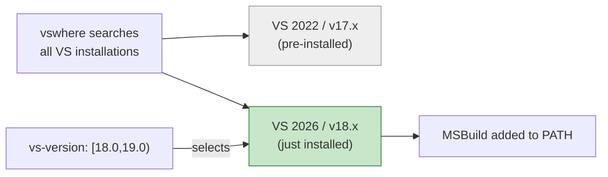

# GitHub Actions CI for C++/CLI NUnit Tests

This guide explains the CI workflow for building and testing the C++/CLI NUnit project on GitHub Actions, why a standard runner is not sufficient out of the box, and how each part of the workflow addresses that.

---

## Contents

1. [Why CI is non-trivial for C++/CLI](#why-ci-is-non-trivial-for-ccli)
2. [Runner and toolset requirements](#runner-and-toolset-requirements)
3. [The workflow file](#the-workflow-file)
4. [Step-by-step explanation](#step-by-step-explanation)
5. [VS 2026 Build Tools components](#vs-2026-build-tools-components)
6. [Expected run times](#expected-run-times)
7. [Troubleshooting CI failures](#troubleshooting-ci-failures)

---

## Why CI is non-trivial for C++/CLI

The project requires the **v145 platform toolset**, which ships with Visual Studio 2026. Earlier versions of the `windows-latest` runner image shipped only Visual Studio 2022 (toolset v143), which caused an immediate build failure:

```
error MSB8020: The build tools for Visual Studio 2026 (Platform Toolset = 'v145') cannot be found.
```

As of the `windows-2025-vs2026` runner image (released June 2026), **`windows-latest` now includes VS 2026**, so no extra installation step is needed. The only requirement is pointing `setup-msbuild` at the right VS version.

---

## Runner and toolset requirements

| Requirement | What provides it | Notes |
|---|---|---|
| `windows-latest` runner | GitHub-hosted | Windows Server 2025 with VS 2026 pre-installed (`windows-2025-vs2026` image) |
| v145 C++ compiler | VS 2026 (pre-installed on runner) | `cl.exe /clr:netcore` |
| C++/CLI support (`/clr:netcore`) | VS 2026 (pre-installed on runner) | Required for mixed-mode assembly |
| MSBuild v18 | VS 2026 (pre-installed on runner) | Selected via `microsoft/setup-msbuild@v2` |
| NuGet CLI | Pre-installed on runner | Used to restore packages |
| .NET 8 runtime | Pre-installed on runner | Required by testhost at test time |
| `vstest.console.exe` | VS 2026 (pre-installed on runner) | `test.cmd` checks VS 2026 path first |

---

## The workflow file

Located at `.github/workflows/CI.yml`:

```yaml
name: CI

on:
  push:
    branches: [ master ]
  pull_request:
    branches: [ master ]

jobs:
  build-and-test:
    runs-on: windows-latest

    steps:
      - name: Checkout
        uses: actions/checkout@v4

      - name: Setup MSBuild (VS 2026 / v18)
        uses: microsoft/setup-msbuild@v2
        with:
          vs-version: '[18.0,19.0)'

      - name: Restore NuGet packages
        run: nuget restore syntax\cpp-cli-syntax.vcxproj

      - name: Build
        run: .\build.cmd

      - name: Test
        run: .\test.cmd
```

---

## Step-by-step explanation

### 1. Checkout

```yaml
- name: Checkout
  uses: actions/checkout@v4
```

Standard checkout. No special configuration needed — the project has no submodules and no LFS assets.

---

### 2. Setup MSBuild

```yaml
- name: Setup MSBuild (VS 2026 / v18)
  uses: microsoft/setup-msbuild@v2
  with:
    vs-version: '[18.0,19.0)'
```

The `microsoft/setup-msbuild` action uses `vswhere` to locate MSBuild and adds it to `PATH`. Without the `vs-version` constraint, it would find VS 2022's MSBuild (v17) first, since that is pre-installed on the runner. `[18.0,19.0)` is a NuGet-style version range meaning "VS 18.x only", which selects the newly installed VS 2026 Build Tools.



---

### 3. Restore NuGet packages

```yaml
- name: Restore NuGet packages
  run: nuget restore syntax\cpp-cli-syntax.vcxproj
```

Restores all `<PackageReference>` entries in the vcxproj into the NuGet cache (`%USERPROFILE%\.nuget\packages\`). This is required before building because the vcxproj's `<Reference>` HintPaths point into the NuGet cache:

```xml
<HintPath>$(USERPROFILE)\.nuget\packages\nunit\5.0.0-alpha.100.20\lib\net8.0\nunit.framework.dll</HintPath>
```

If the packages are not restored first, MSBuild cannot find the assemblies and compilation fails.

> **Why `nuget restore` and not `dotnet restore`?** This is a traditional `.vcxproj` file, not an SDK-style project. `dotnet restore` is designed for SDK-style projects (`.csproj` with `<Project Sdk="...">`). `nuget restore` with a vcxproj is the correct tool here.

---

### 4. Build

```yaml
- name: Build
  run: .\build.cmd
```

Runs `build.cmd` from the repo root, which calls MSBuild on `syntax\cpp-cli-syntax.vcxproj` and then unconditionally copies all required runtime DLLs to `syntax\Debug\`. The unconditional copy step in `build.cmd` is important: MSBuild's post-build event is skipped on incremental builds, but in CI the NuGet cache is cold and the output directory is empty, so the copies are always needed.

See [build.cmd](../build.cmd) and the [Setup Guide](cpp-cli-nunit-guide.md#post-build-copying-runtime-dependencies) for the full list of DLLs copied and why each is needed.

---

### 5. Test

```yaml
- name: Test
  run: .\test.cmd
```

Runs `test.cmd` from the repo root, which locates `vstest.console.exe` and runs it against `syntax\Debug\cpp-cli-syntax.dll`. On the CI runner, the VS 2026 path is checked first, then falls back to VS 2022. Since VS 2026 Build Tools (not the full IDE) are installed in CI, vstest comes from the pre-installed VS 2022.

A successful run looks like:

```
NUnit Adapter 1.0.0.0: Test execution started
Running all tests in ...cpp-cli-syntax.dll
   NUnit3TestExecutor discovered 34 of 34 NUnit test cases
  Passed AllItemsTests
  Passed AndOperator
  ...
Test Run Successful.
Total tests: 34
     Passed: 34
```

---

## VS 2026 Build Tools components

Only two components (plus their recommended dependencies) are installed, keeping the install as lean as possible.

| Component ID | What it provides | Why it is needed |
|---|---|---|
| `Microsoft.VisualStudio.Workload.VCTools` | The full C++ build tools workload: v145 compiler (`cl.exe`), linker, headers, Windows SDK | Core requirement — without this there is no C++ compiler |
| `Microsoft.VisualStudio.Component.VC.CLI.Support` | C++/CLI language support for the v145 toolset | Enables `/clr:netcore` compilation mode for mixed-mode assemblies |
| `--includeRecommended` | Windows SDK, CMake, ATL/MFC headers (recommended sub-components) | Pulls in the Windows SDK which provides the OS headers needed even for .NET-targeted code |

Components that are **not** installed (and not needed):

| Component | Why omitted |
|---|---|
| Full Visual Studio IDE | Not needed for command-line builds |
| `Microsoft.VisualStudio.Workload.ManagedDesktop` | C# build support — not required for C++/CLI |
| VS 2022 toolset (v143) | Not needed; project targets v145 |

---

## Expected run times

| Step | Typical duration |
|---|---|
| Checkout | < 1 min |
| Setup MSBuild | < 1 min |
| Restore NuGet packages | 1–3 min (cold cache) |
| Build | 1–2 min |
| Test | < 1 min |
| **Total** | **~3–6 min** |

Because VS 2026 is pre-installed on the runner, there is no lengthy tooling installation step. The NuGet restore dominates on cold cache runs.

---

## Troubleshooting CI failures

### MSB8020: Build tools for v145 not found

```
error MSB8020: The build tools for Visual Studio 2026 (Platform Toolset = 'v145') cannot be found.
```

The `setup-msbuild` action picked up VS 2022 instead of VS 2026. Check that `vs-version: '[18.0,19.0)'` is present on the `setup-msbuild` step and that `microsoft/setup-msbuild@v2` is used (older versions may not support the `vs-version` input). If the runner image ever reverts to VS 2022 only, check the runner image name in the job log header — it should say `windows-2025-vs2026`.

### NuGet restore fails on pre-release package

```
Unable to find version '5.0.0-alpha.100.20' of package 'NUnit'.
```

The NuGet CLI on the runner may not be searching pre-release versions. Add a `nuget.config` at the repo root that explicitly targets nuget.org:

```xml
<?xml version="1.0" encoding="utf-8"?>
<configuration>
  <packageSources>
    <add key="nuget.org" value="https://api.nuget.org/v3/index.json" protocolVersion="3" />
  </packageSources>
</configuration>
```

### vstest.console.exe not found

```
ERROR: Could not find vstest.console.exe
```

The `test.cmd` checks for VS 2026 Enterprise paths. The `windows-2025-vs2026` runner image installs VS 2026 **Enterprise**, so the path should exist. If the runner image changes the install location, update `test.cmd` to add the new path. You can find it on the runner with:

```powershell
vswhere -latest -find **\vstest.console.exe
```

### FileNotFoundException for runtime DLLs

```
Failed to load the test assembly ...
System.IO.FileNotFoundException: Could not load file or assembly 'Microsoft.Extensions.DependencyModel'
```

The DLL copy step in `build.cmd` did not run, or a NuGet package was not restored. This typically means the NuGet restore step ran but a package was missing from nuget.org (e.g., the alpha NUnit package was delisted). Check the restore step output.

See [Troubleshooting](troubleshooting.md) for the full list of required runtime DLLs and their source packages.
