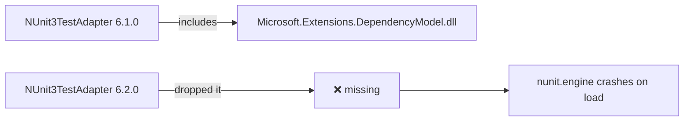

# Troubleshooting C++/CLI NUnit Tests

This page documents the specific failures that occur when setting up C++/CLI NUnit tests on .NET Core, what causes them, and how to fix them.

---

## Contents

1. [testhost hangs — no output after "1 test files matched"](#testhost-hangs)
2. [FileNotFoundException: System.Security.Permissions](#filenotfoundexception-systemsecuritypermissions)
3. [FileNotFoundException: Microsoft.Extensions.DependencyModel](#filenotfoundexception-microsoftextensionsdependencymodel)
4. [Build syntax errors after upgrading to NUnit 4/5](#build-syntax-errors-after-upgrading-to-nunit-45)
5. [DLLs missing after incremental build](#dlls-missing-after-incremental-build)
6. [Red squiggles and false errors in Visual Studio](#red-squiggles-and-false-errors-in-visual-studio)

---

## testhost hangs

**Symptom**

```
Starting test execution, please wait...
A total of 1 test files matched the specified pattern.
[hangs indefinitely]
```

vstest.console.exe never returns. Killing it leaves orphaned `dotnet.exe` processes.

**Root cause**

The most common cause is a `TargetFramework` mismatch between the test assembly and the packages that ship `testhost.dll`.


If the project's `TargetFramework` is `net10.0` but all NuGet packages only ship `net8.0` builds, the .NET 10 runtime loads the `net8.0` testhost via roll-forward. The testhost then tries to communicate with vstest but fails due to assembly load problems in the new runtime version, and exits silently. vstest then waits 90 seconds before timing out.

**Fix**

Set `TargetFramework` to `net8.0` in the vcxproj to match the packages:

```xml
<PropertyGroup Label="Globals">
    ...
    <TargetFramework>net8.0</TargetFramework>
</PropertyGroup>
```

Check what framework versions the installed adapter actually ships:

```powershell
Get-ChildItem "$env:USERPROFILE\.nuget\packages\nunit3testadapter\6.2.0\build" -Directory
Get-ChildItem "$env:USERPROFILE\.nuget\packages\microsoft.testplatform.testhost\*\lib" -Directory
```

The `TargetFramework` in the vcxproj must match one of these.

---

## FileNotFoundException: System.Security.Permissions

**Symptom**

```
Exception: System.IO.FileNotFoundException
Message: Could not load file or assembly
  'System.Security.Permissions, Version=0.0.0.0, ...'
Stack Trace:
  at Newtonsoft.Json.Serialization.JsonTypeReflector.get_DynamicCodeGeneration()
  ...
Failed processing message ProtocolVersion, aborting test run.
```

The testhost connects to vstest, receives the first protocol message, then crashes.

**Root cause**

Newtonsoft.Json (bundled with the testplatform) checks for `System.Security.Permissions` on startup to decide whether it can use dynamic code generation. On .NET Core, this assembly is not part of `Microsoft.NETCore.App` — it must be present as a separate DLL. When it is missing, `Newtonsoft.Json` throws `FileNotFoundException` instead of catching it gracefully, which crashes the testhost.

**Fix**

Add the package reference and copy the DLL to the output directory.

In the vcxproj `<ItemGroup>` with PackageReferences:

```xml
<PackageReference Include="System.Security.Permissions">
    <Version>9.0.0</Version>
</PackageReference>
```

Add a compile-time Reference (so the compiler knows about it):

```xml
<Reference Include="System.Security.Permissions">
    <HintPath>$(USERPROFILE)\.nuget\packages\system.security.permissions\9.0.0\lib\net8.0\System.Security.Permissions.dll</HintPath>
    <Private>true</Private>
</Reference>
```

Add a copy to the post-build event:

```batch
copy /Y "%USERPROFILE%\.nuget\packages\system.security.permissions\9.0.0\lib\net8.0\System.Security.Permissions.dll" "$(OutDir)"
```

> **Version note:** Use version 9.0.0 (which has a `net8.0` build) rather than 8.0.0 (which does not exist in the public NuGet feed).

---

## FileNotFoundException: Microsoft.Extensions.DependencyModel

**Symptom**

```
Exception NUnit.Engine.NUnitEngineException,
  Exception thrown executing tests in ...cpp-cli-syntax.dll
Failed to load the test assembly ...
InnerException: System.IO.FileNotFoundException:
  Could not load file or assembly
  'Microsoft.Extensions.DependencyModel, Version=8.0.0.2, ...'
  at NUnit.Engine.Internal.RuntimeLibrariesStrategy..ctor(...)
```

The testhost starts correctly and the adapter loads, but the NUnit engine crashes when trying to load the test assembly.

**Root cause**

`nunit.engine` uses `Microsoft.Extensions.DependencyModel` to resolve assembly paths when loading the test DLL. This DLL was bundled inside `NUnit3TestAdapter` up through version 6.1.x but was **removed in 6.2.0**.



**Fix**

Add the package and copy it explicitly. Do **not** add it as a compile-time `<Reference>` — doing so causes C4945 warnings because it re-exports types from `System.Collections`.

PackageReference only:

```xml
<PackageReference Include="Microsoft.Extensions.DependencyModel">
    <Version>8.0.0</Version>
</PackageReference>
```

Post-build copy:

```batch
copy /Y "%USERPROFILE%\.nuget\packages\microsoft.extensions.dependencymodel\8.0.0\lib\net8.0\Microsoft.Extensions.DependencyModel.dll" "$(OutDir)"
```

---

## Build syntax errors after upgrading to NUnit 4/5

Several API changes in NUnit 4/5 break C++/CLI code that was written for NUnit 3.

### Duplicate method name (C2686)

**Symptom**

```
error C2686: cannot overload static and non-static member functions
  with the same parameter types
```

**Cause:** A class has both a static and non-static method with the same name. C++/CLI does not allow this even if one is used as a delegate target and the other is not.

**Fix:** Rename or remove the static duplicate. If you need both, give them different names.

### Assert.Throws no longer accepts a Type argument

**Symptom**

```
error C2661: 'NUnit::Framework::Assert::Throws': no overloaded function takes 1 arguments
```

**Cause:** NUnit 4/5 removed `Assert.Throws(Type, Action)`. Only the generic form exists now.

**Fix:**

```cpp
// Before (NUnit 3)
Assert::Throws(
    System::ArgumentException::typeid,
    gcnew System::Action(this, &MyTests::ThrowsHelper));

// After (NUnit 4/5)
Assert::Throws<System::ArgumentException^>(
    gcnew System::Action(this, &MyTestClass::ThrowsHelper));
```

Also ensure the class name in the delegate matches the **enclosing test class**, not the method name.

### Assert.Pass does not accept format arguments

**Symptom**

```
error C2661: 'NUnit::Framework::Assert::Pass': no overloaded function takes 2 arguments
```

**Fix:** Pre-format the string:

```cpp
// Before
Assert::Pass("Passed at {0}", System::DateTime::Now);

// After
Assert::Pass(String::Format("Passed at {0}", System::DateTime::Now));
```

---

## DLLs missing after incremental build

**Symptom**

Tests fail with `FileNotFoundException` for one of the runtime DLLs, but only after a rebuild where no source files changed. A full clean rebuild fixes it.

**Root cause**

MSBuild skips the `<PostBuildEvent>` when it determines the project is already up-to-date. This means the copy commands in the post-build event are never re-run, and if the output directory was cleaned or the DLLs were deleted, they stay missing.

**Fix**

Add unconditional copy commands to `build.cmd`, **after** the MSBuild invocation, so they run regardless of whether MSBuild considers the project up-to-date:

```batch
msbuild cpp-cli-syntax.vcxproj /t:Build /p:Configuration=Debug /p:Platform=x64 /v:minimal /nologo

if %ERRORLEVEL% NEQ 0 goto :error

REM Always copy — post-build is skipped on incremental builds
copy /Y "%USERPROFILE%\.nuget\packages\nunit3testadapter\6.2.0\build\net8.0\*.dll" "Debug\" >nul
copy /Y "%USERPROFILE%\.nuget\packages\nunit\5.0.0-alpha.100.20\lib\net8.0\nunit.framework.legacy.dll" "Debug\" >nul
copy /Y "%USERPROFILE%\.nuget\packages\system.security.permissions\9.0.0\lib\net8.0\System.Security.Permissions.dll" "Debug\" >nul
copy /Y "%USERPROFILE%\.nuget\packages\microsoft.extensions.dependencymodel\8.0.0\lib\net8.0\Microsoft.Extensions.DependencyModel.dll" "Debug\" >nul
```

This is safe to do unconditionally — `copy /Y` is idempotent and fast.

---

## Red squiggles and false errors in Visual Studio

**Symptom**

The editor underlines NUnit assertion code in red, and the Error List shows messages like:

```
'Within' is not a member of '...'
'IgnoreCase' is not a member of '...'
'AreEqual' : is not a member of 'NUnit::Framework::Assert'
C4642: could not import the constraints for generic parameter 'T'
```

**Root cause**

These are IntelliSense analysis errors, not compiler errors. The Visual Studio C++/CLI IntelliSense engine cannot fully model:

- NUnit's generic type constraints on fluent chains (`->Within()`, `->IgnoreCase`)
- C# extension methods (used by NUnit 4/5 for the classic assert API on `Assert`)

**Fix**

There is no fix — these are inherent limitations of the C++/CLI IntelliSense engine with NUnit's generic API design.

For the classic assert methods specifically, the situation is:

- **NUnit 4** moved them from `Assert` to `NUnit.Framework.Legacy.ClassicAssert`
- **NUnit 5** added them back onto `Assert` — but as **C# static extension methods** that simply call through to `ClassicAssert`

C++/CLI cannot call C# extension methods, so `Assert::AreEqual` etc. remain invisible. Use `ClassicAssert` directly:

```cpp
using namespace NUnit::Framework::Legacy;

// Wrong — AreEqual is a C# extension method on Assert in NUnit 5, invisible to C++/CLI
Assert::AreEqual(4, 2 + 2);

// Correct — call ClassicAssert directly, bypassing the extension method layer
ClassicAssert::AreEqual(4, 2 + 2);
```

For fluent constraint chains, trust `build.cmd` over the editor. If the build succeeds, the code is correct:

```cpp
// May show red in editor — compiles and runs fine
Assert::That(4.99, Is::EqualTo(5.0)->Within(0.05));
Assert::That(phrase, Does::Contain("WORLD")->IgnoreCase);
```

> **Rule of thumb:** Red squiggles in the editor = ignore. Errors in `build.cmd` output = fix.
